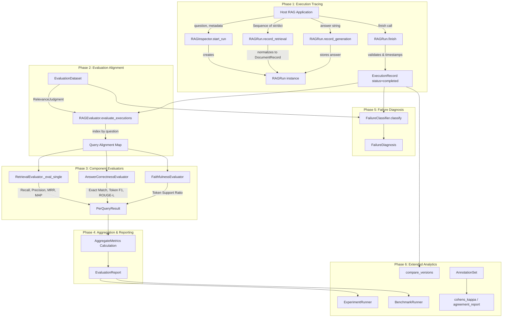

# RAG Inspector SDK: Architecture, Data Flow, and Technical Reference

This document provides a comprehensive, rigorous technical reference for the **RAG Inspector SDK** (`rag-inspector-sdk`). It details the internal mechanics, public APIs, data representations, input validation rules, transformation pipelines, mathematical calculations, failure diagnostics, error-handling behaviors, and serialized outputs based strictly on the source code implemented in `rag-inspector-sdk/src/rag_inspector/`.

---

## Table of Contents

1. [Architectural Overview & Implementation Scope](#1-architectural-overview--implementation-scope)
2. [Complete Chronological Data Flow Pipeline](#2-complete-chronological-data-flow-pipeline)
   - [Phase 1: Execution Tracing](#phase-1-execution-tracing)
   - [Phase 2: Dataset Association & Alignment](#phase-2-dataset-association--alignment)
   - [Phase 3: Component Evaluation Engines](#phase-3-component-evaluation-engines)
   - [Phase 4: Metric Aggregation & Report Generation](#phase-4-metric-aggregation--report-generation)
   - [Phase 5: Failure Diagnosis Classification](#phase-5-failure-diagnosis-classification)
   - [Phase 6: Extended Analytics & Experiment Orchestration](#phase-6-extended-analytics--experiment-orchestration)
3. [Comprehensive Public Input Specification](#3-comprehensive-public-input-specification)
4. [Execution Tracing Lifecycle & Normalization](#4-execution-tracing-lifecycle--normalization)
5. [Evaluation Processing & Mathematical Formulas](#5-evaluation-processing--mathematical-formulas)
   - [Retrieval Metrics (Recall@k, Precision@k, MRR, MAP, nDCG)](#retrieval-metrics)
   - [Generation Metrics (Exact Match, Token F1, ROUGE-L Approximation)](#generation-metrics)
   - [Faithfulness Metric (Lexical Token Support Ratio)](#faithfulness-metric)
   - [Metric Aggregation Mechanics](#metric-aggregation-mechanics)
6. [Failure Diagnosis Engine](#6-failure-diagnosis-engine)
7. [Extended Analytics Modules](#7-extended-analytics-modules)
   - [Human Annotation & Inter-Rater Agreement (Cohen's Kappa)](#human-annotation--inter-rater-agreement)
   - [Diagnostic Confusion Matrix & Classification Report](#diagnostic-confusion-matrix--classification-report)
   - [RAG Version Comparison & Bootstrap Confidence Intervals](#rag-version-comparison--bootstrap-confidence-intervals)
   - [LLM Judge Stability & Order Bias Analysis](#llm-judge-stability--order-bias-analysis)
   - [Performance Benchmarking Harness](#performance-benchmarking-harness)
   - [Experiment Runner & Artifact Persistence](#experiment-runner--artifact-persistence)
8. [Comprehensive Output Schemas & Serialization](#8-comprehensive-output-schemas--serialization)
9. [Module Traceability & Dependency Map](#9-module-traceability--dependency-map)
10. [End-to-End Worked Example & Edge Cases](#10-end-to-end-worked-example--edge-cases)
11. [What the SDK Does Not Do (Boundaries & Limitations)](#11-what-the-sdk-does-not-do-boundaries--limitations)
12. [Discrepancy Audit & Synchronization Notes](#12-discrepancy-audit--synchronization-notes)

---

## 1. Architectural Overview & Implementation Scope

The RAG Inspector SDK provides execution tracing, diagnostic classification, and evaluation capabilities for Retrieval-Augmented Generation (RAG) pipelines. It is designed to be framework-independent, operating on standard Python primitives (strings, sequences, dictionaries) without requiring dependencies on LangChain, LlamaIndex, or remote APIs.

### 1.1 Directory & Module Structure

The package root is `rag-inspector-sdk/src/rag_inspector/`:

```
rag-inspector-sdk/src/rag_inspector/
├── __init__.py                # Package exports (tracing + evaluation + analytics)
├── errors.py                  # Custom exception hierarchy
├── schemas.py                 # Core tracing data models (DocumentRecord, ExecutionRecord, RunStatus)
├── inspector.py               # RAGInspector entry point
├── run.py                     # RAGRun tracing lifecycle controller
├── evaluation/                # Evaluation subsystem
│   ├── __init__.py            # Evaluation exports
│   ├── config.py              # EvaluationConfig dataclass
│   ├── dataset.py             # EvaluationDataset, RelevanceJudgment, LabeledQuery
│   ├── metrics.py             # Pure mathematical metric implementations
│   ├── results.py             # PerQueryResult and AggregateMetrics dataclasses
│   ├── evaluator.py           # RetrievalEvaluator, AnswerCorrectnessEvaluator, FaithfulnessEvaluator
│   ├── orchestrator.py        # RAGEvaluator orchestration engine
│   └── report.py              # EvaluationReport dataclass with JSON/dict/summary exporters
├── diagnostics/               # Diagnostic subsystem
│   ├── __init__.py            # Diagnostics exports
│   ├── taxonomy.py            # FailureType enum, FailureDiagnosis, FailureClassifier
│   └── confusion.py           # confusion_matrix and classification_report generators
├── annotation/                # Annotation subsystem
│   ├── __init__.py            # Annotation exports
│   ├── schema.py              # AnnotationRecord, AnnotationSet (with JSONL I/O)
│   └── agreement.py           # cohens_kappa and agreement_report
├── comparison/                # Comparative evaluation subsystem
│   ├── __init__.py            # Comparison exports
│   └── version_compare.py     # VersionComparison dataclass and compare_versions with bootstrap CI
├── judge/                     # Judge evaluation subsystem
│   ├── __init__.py            # Judge exports
│   ├── base.py                # JudgeResult dataclass and JudgeProvider Protocol
│   └── stability.py           # JudgeStabilityReport and JudgeStabilityExperiment
├── benchmark/                 # Performance benchmarking subsystem
│   ├── __init__.py            # Benchmark exports
│   └── runner.py              # BenchmarkResult dataclass and BenchmarkRunner
├── experiments/               # Experiment management subsystem
│   ├── __init__.py            # Experiments exports
│   └── runner.py              # ExperimentConfig and ExperimentRunner (JSON + Markdown output)
├── adapters/                  # [Placeholder] Framework adapters (currently empty directory)
└── utils/                     # [Placeholder] Utility helpers (currently empty directory)
```

### 1.2 Implementation Status Matrix

| Subsystem / Feature | Module | Implementation Status | Implementation Nature |
|---|---|---|---|
| **Execution Tracing** | `inspector.py`, `run.py`, `schemas.py` | **Fully Implemented** | Deterministic, in-memory, zero external dependencies |
| **Error Hierarchy** | `errors.py` | **Fully Implemented** | Typed exception hierarchy inheriting from `RAGInspectorError` |
| **Evaluation Dataset** | `evaluation/dataset.py` | **Fully Implemented** | In-memory query-to-judgment mapping with JSON/dict import/export |
| **Retrieval Evaluation** | `evaluation/evaluator.py`, `evaluation/metrics.py` | **Fully Implemented** | Exact set & ranking calculations (Recall@k, Precision@k, MRR, MAP, nDCG) |
| **Answer Correctness** | `evaluation/evaluator.py` | **Fully Implemented** | Lexical token overlap, Exact Match, Token F1, ROUGE-L approximation |
| **Faithfulness / Grounding** | `evaluation/evaluator.py` | **Fully Implemented** | Lexical token overlap between answer and concatenated retrieved document text |
| **Abstention Metrics** | `evaluation/results.py`, `evaluation/config.py` | **Partially Implemented** | Configuration flag and result dictionary field exist; populated via failure diagnosis |
| **Failure Classification** | `diagnostics/taxonomy.py` | **Fully Implemented** | Heuristic decision tree assigning primary failure types and evidence |
| **Confusion Matrix & Reports**| `diagnostics/confusion.py` | **Fully Implemented** | Standard multi-class confusion matrix, precision, recall, F1, macro-F1 |
| **Annotator Agreement** | `annotation/agreement.py` | **Fully Implemented** | Cohen's Kappa ($\kappa$) and raw agreement calculations |
| **Annotation Serialization** | `annotation/schema.py` | **Fully Implemented** | `AnnotationRecord` and `AnnotationSet` with JSONL file persistence |
| **RAG Version Comparison** | `comparison/version_compare.py` | **Fully Implemented** | Paired query matching, deltas, relative changes, percentile bootstrap CI |
| **Judge Stability** | `judge/stability.py` | **Fully Implemented** | Inter-judge agreement, Cohen's kappa, permutation shuffling for order effects |
| **Judge Provider Protocol** | `judge/base.py` | **Protocol / Interface Only** | `JudgeProvider(Protocol)` is defined; no remote provider clients (e.g. OpenAI) exist in core |
| **Benchmark Runner** | `benchmark/runner.py` | **Fully Implemented** | Wall-clock latency measurement (`perf_counter`), QPS throughput, target validation |
| **Experiment Runner** | `experiments/runner.py` | **Fully Implemented** | Batch evaluation saving structured JSON and Markdown reports to disk |
| **Framework Adapters** | `adapters/` | **Not Implemented / Empty** | Intentionally empty; framework objects must be converted explicitly |
| **Utility Functions** | `utils/` | **Not Implemented / Empty** | Directory reserved for internal helpers |

---

## 2. Complete Chronological Data Flow Pipeline

The end-to-end data flow operates in six distinct phases. The diagram below illustrates how data transitions across modules:



---

### Detailed Processing Stages

#### Step 1: Run Initialization
1. **What enters:** A non-empty query `question: str` and an optional dictionary `metadata: dict | None` passed by the calling application.
2. **Handling module:** `rag_inspector/inspector.py` -> `RAGInspector.start_run(question: str, *, metadata: dict | None = None)`.
3. **Internal processing:**
   - Validates that `question` is an instance of `str` and `bool(question.strip())` evaluates to `True`.
   - Validates that `metadata` is either `None` or an instance of `dict`.
   - Generates a unique execution identifier using `str(uuid4())`.
   - Captures start timestamp in UTC ISO 8601 format using `utc_now_iso()`.
4. **Data changes:** Instantiates internal `ExecutionRecord(run_id=..., question=question.strip(), started_at=..., metadata=dict(metadata or {}), status=RunStatus.RECORDING)`.
5. **Error handling:**
   - If `question` is not a string or is empty/whitespace: raises `InvalidQuestionError("Required pipeline input 'question' must be a non-empty string.")`.
   - If `metadata` is not a dictionary: raises `TypeError("'metadata' must be a dictionary when provided.")`.
6. **What leaves:** Returns an active `RAGRun` instance in state `RunStatus.RECORDING`.

#### Step 2: Retrieval Recording & Normalization
1. **What enters:** A sequence `documents: Sequence[str | dict[str, Any]]` passed by the calling application.
2. **Handling module:** `rag_inspector/run.py` -> `RAGRun.record_retrieval(documents: Sequence[str | dict[str, Any]])`.
3. **Internal processing:**
   - Calls `_ensure_recording()` to assert that the run is still in state `RunStatus.RECORDING`.
   - Rejects non-sequence types, `str`, or `bytes` directly.
   - Iterates through `documents` by index:
     - If `document` is `str`: sets `text = document`, `id = None`, `metadata = {}`.
     - If `document` is `dict`: extracts `text = document.get("text")`, `doc_id = document.get("id")`, `metadata = document.get("metadata", {})`. Validates that `text` is a non-empty string, `doc_id` is a string or `None`, and `metadata` is a dictionary.
     - If `document` is any other type (such as LangChain `Document` or LlamaIndex `Node`): rejects without silent stringification.
   - Validates that `text.strip()` is non-empty.
   - Instantiates a frozen `DocumentRecord(text=text, id=doc_id, metadata=dict(metadata))` for each item.
4. **Data changes:** `self._record.retrieved_documents` transitions from `None` to `list[DocumentRecord]`. If `documents == []`, it is set to `[]`.
5. **Error handling:**
   - If already completed: raises `RunStateError`.
   - If `documents` is a string, bytes, or not a sequence: raises `InvalidRetrievalError`.
   - If any document is missing `text`, has empty `text`, non-string `id`, non-dict `metadata`, or is an unrecognized object: raises `InvalidDocumentError` with index details.
6. **What leaves:** Returns `self` (`RAGRun`) to support fluent method chaining.

#### Step 3: Generation Recording
1. **What enters:** Generated text `answer: str` passed by the application.
2. **Handling module:** `rag_inspector/run.py` -> `RAGRun.record_generation(answer: str)`.
3. **Internal processing:**
   - Calls `_ensure_recording()`.
   - Validates that `answer` is a string and `bool(answer.strip())` is `True`.
4. **Data changes:** `self._record.answer` transitions from `None` to `answer.strip()`.
5. **Error handling:**
   - If run is completed: raises `RunStateError`.
   - If `answer` is not a string, is empty, or consists solely of whitespace: raises `InvalidAnswerError("Required pipeline output 'answer' must be a non-empty string.")`.
6. **What leaves:** Returns `self` (`RAGRun`).

#### Step 4: Run Finalization & Validation
1. **What enters:** Invocation of `run.finish()`.
2. **Handling module:** `rag_inspector/run.py` -> `RAGRun.finish()`.
3. **Internal processing:**
   - Calls `_ensure_recording()`.
   - Checks whether `self._record.retrieved_documents is None`.
   - Checks whether `self._record.answer is None`.
   - If either stage is missing, collects the missing field descriptions.
   - Records finished timestamp using `utc_now_iso()`.
   - Updates status to `RunStatus.COMPLETED`.
4. **Data changes:** `self._record.finished_at` is assigned UTC ISO timestamp string; `self._record.status` becomes `RunStatus.COMPLETED`. The run becomes immutable.
5. **Error handling:**
   - If stages are missing: raises `MissingPipelineDataError(missing)` where `missing` contains `"retrieval documents (call record_retrieval(...))"` and/or `"generated answer (call record_generation(...))"`.
   - If called on an already completed run: raises `RunStateError`.
6. **What leaves:** Returns the finalized `ExecutionRecord`.

#### Step 5: Dataset Association & Evaluator Orchestration
1. **What enters:** One or more completed `ExecutionRecord` instances and an optional `EvaluationDataset` passed to `RAGEvaluator.evaluate_executions(...)`.
2. **Handling module:** `rag_inspector/evaluation/orchestrator.py` -> `RAGEvaluator.evaluate_executions(executions, dataset=None)`.
3. **Internal processing:**
   - Normalizes single execution into a list.
   - Creates a lookup dictionary `exec_by_query = {ex.question.strip(): ex for ex in executions}`.
   - Determines query set: if `dataset is not None`, targets `dataset.queries()`; otherwise targets `list(exec_by_query.keys())`.
   - Dispatches executions to active component evaluators (`RetrievalEvaluator`, `AnswerCorrectnessEvaluator`, `FaithfulnessEvaluator`) based on `EvaluationConfig`.
   - Aligns component evaluation results by normalized query string.
   - Checks for missing executions: if a query exists in `dataset` but has no corresponding execution, either records an error `errors=["missing_execution"]` or raises `ValueError` if `config.strict_missing_runs` is `True`.
4. **Data changes:** Merges metrics from all three evaluators into a unified `PerQueryResult` for each query.
5. **Error handling:**
   - If `strict_missing_runs=True` and a dataset query lacks an execution: raises `ValueError(f"No execution found for query in dataset: {q}")`.
   - If `strict_missing_runs=False`: creates `PerQueryResult(query=q, errors=["missing_execution"])` and excludes it from aggregate means.
6. **What leaves:** Generates `list[PerQueryResult]`, forwarded to metric aggregation.

#### Step 6: Retrieval Evaluation Processing
1. **What enters:** `ExecutionRecord`, `EvaluationDataset`, and `EvaluationConfig` handled by `RetrievalEvaluator._eval_single`.
2. **Handling module:** `rag_inspector/evaluation/evaluator.py` -> `RetrievalEvaluator`.
3. **Internal processing:**
   - Extracts document IDs: inspects each document for attribute `id`, dictionary key `"id"`, or falls back to `""`.
   - Queries `dataset.get_relevant_ids(query)`.
   - If no relevant IDs exist and `cfg.ignore_missing_relevant` is `True`: sets `details["note"] = "no_relevant_annotations"` and returns empty retrieval metrics.
   - For each $k \in \text{cfg.k\_values}$ (default `[1, 3, 5, 10]`): computes `recall@k` and `precision@k`.
   - Computes `mrr` (unbounded), `mrr@10` (bounded to first 10 docs), and `map` (average precision across retrieved length).
4. **Data changes:** Populates `PerQueryResult.retrieval_metrics` dictionary and `retrieved_doc_ids`.
5. **Error handling:**
   - If `dataset` is `None`: returns `PerQueryResult` with empty metrics.
   - If zero documents retrieved: sets `recall@k = 0.0`, `precision@k = 0.0`, `mrr = 0.0`, `map = 0.0`.
6. **What leaves:** Forwarded back to orchestrator.

#### Step 7: Answer Correctness Processing
1. **What enters:** `ExecutionRecord` and `EvaluationDataset`.
2. **Handling module:** `rag_inspector/evaluation/evaluator.py` -> `AnswerCorrectnessEvaluator`.
3. **Internal processing:**
   - Retrieves `expected_answer = dataset.get_expected_answer(ex.question)`.
   - If `expected_answer` is missing: sets `details["note"] = "no_expected_answer"`.
   - Tokenizes predicted answer and expected answer using regex `_tokenize(s) = set(re.findall(r"\w+", s.lower()))`.
   - If expected tokens are empty: computes exact match via case-sensitive strip comparison.
   - If expected tokens exist:
     - Computes token intersection `overlap = len(pred_tokens & exp_tokens)`.
     - Computes Token F1: $\frac{2 \cdot \text{overlap}}{|\text{pred\_tokens}| + |\text{exp\_tokens}|}$.
     - Computes Exact Match: $1.0$ if `pred.lower().strip() == exp.lower().strip()` else $0.0$.
     - Computes ROUGE-L approximation: $\min\left(\frac{\text{overlap}}{|\text{exp\_tokens}|}, 1.0\right)$.
4. **Data changes:** Populates `PerQueryResult.answer_metrics`.
5. **Error handling:** If answer or dataset is missing, sets `details["note"] = "missing_dataset_or_answer"`.
6. **What leaves:** Forwarded to orchestrator.

#### Step 8: Faithfulness Processing
1. **What enters:** `ExecutionRecord` containing `answer` and `retrieved_documents`.
2. **Handling module:** `rag_inspector/evaluation/evaluator.py` -> `FaithfulnessEvaluator`.
3. **Internal processing:**
   - If `answer` is empty: sets `faithfulness = 0.0`.
   - Extracts all document texts from `retrieved_documents`.
   - If no context texts exist: sets `faithfulness = 0.0` and `details["note"] = "no_context"`.
   - Tokenizes answer into `ans_tokens` and union of all context texts into `ctx_tokens`.
   - If `ans_tokens` is empty: sets `faithfulness = 1.0`.
   - Computes supported tokens: `supported = len(ans_tokens & ctx_tokens)`.
   - Computes score: $\frac{\text{supported}}{|\text{ans\_tokens}|}$.
4. **Data changes:** Populates `PerQueryResult.faithfulness_metrics["faithfulness"]`.
5. **Error handling:** Returns zero score on missing context or missing answer.
6. **What leaves:** Forwarded to orchestrator.

#### Step 9: Metric Aggregation & Report Generation
1. **What enters:** Merged `list[PerQueryResult]`.
2. **Handling module:** `rag_inspector/evaluation/orchestrator.py` -> `RAGEvaluator.evaluate_executions`.
3. **Internal processing:**
   - Filters out queries containing non-empty `errors`.
   - Tallies `num_queries = len(all_queries)` and `num_evaluated = len(valid_queries)`.
   - Computes arithmetic mean for each metric across evaluated queries:
     $$\mu_m = \frac{1}{N_{\text{eval}}} \sum_{i=1}^{N_{\text{eval}}} v_{i,m}$$
   - Groups aggregates by category (`retrieval`, `answer`, `faithfulness`, `abstention`).
   - Packages into `AggregateMetrics` and `EvaluationReport`.
4. **Data changes:** Instantiates `EvaluationReport` with configuration snapshot and metadata.
5. **Error handling:** If no queries evaluate successfully, aggregate metric dictionaries remain empty.
6. **What leaves:** Final `EvaluationReport` returned in memory to caller.

#### Step 10: Failure Diagnosis Classification
1. **What enters:** `ExecutionRecord` and optional `EvaluationDataset`.
2. **Handling module:** `rag_inspector/diagnostics/taxonomy.py` -> `FailureClassifier.classify(execution, dataset=None, context=None)`.
3. **Internal processing:**
   - Gathers evidence: `num_retrieved`, `has_answer`, `num_relevant_annotated`.
   - Evaluates decision tree:
     1. If no annotated relevant IDs: returns `FailureType.UNKNOWN` (`unclassified=True`).
     2. If retrieved documents have zero intersection with annotated relevant documents:
        - If `num_retrieved == 0`: returns `FailureType.MISSING_RELEVANT_EVIDENCE`.
        - If `num_retrieved > 0`: returns `FailureType.WRONG_OR_IRRELEVANT_RETRIEVAL`.
     3. If relevant documents were retrieved:
        - If answer is present: computes token overlap between answer and context. If answer length $> 10$ tokens and overlap $< 10\%$, returns `FailureType.UNSUPPORTED_HALLUCINATION`. Otherwise returns `FailureType.INCOMPLETE_OR_INCORRECT_GENERATION`.
        - If answer is missing/empty: returns `FailureType.INCORRECT_ABSTENTION`.
4. **Data changes:** Returns `FailureDiagnosis` containing primary category, evidence dictionary, and explanation.
5. **Error handling:** Catches dataset query extraction exceptions and gracefully falls back to `FailureType.UNKNOWN`.
6. **What leaves:** `FailureDiagnosis` object.

---

## 3. Comprehensive Public Input Specification

The following reference details every public input accepted across the SDK:

| Field Name | Accepted Types | Required / Optional | Default Value | Validation Rules | Consuming Component | Missing / Invalid Behavior | Realistic Example |
|---|---|---|---|---|---|---|---|
| `question` | `str` | **Required** | *None* | Must be `str`, cannot be empty or whitespace | `RAGInspector.start_run` | Raises `InvalidQuestionError` | `"What are the admission requirements for AI?"` |
| `metadata` | `dict[str, Any] \| None` | Optional | `{}` | If provided, must be `dict` | `RAGInspector.start_run` | Raises `TypeError` | `{"model": "qwen3:8b", "top_k": 5}` |
| `documents` | `Sequence[str \| dict]` | **Required** | *None* | Must be sequence; cannot be `str` or `bytes`. Empty list `[]` allowed | `RAGRun.record_retrieval` | Raises `InvalidRetrievalError` | `[{"id": "doc-1", "text": "Passage text"}]` |
| `document["text"]` | `str` | **Required** (if dict) | *None* | Must be `str`, non-empty, non-whitespace | `RAGRun.record_retrieval` | Raises `InvalidDocumentError` | `"The curriculum covers deep learning."` |
| `document["id"]` | `str \| None` | Optional | `None` | If provided, must be `str` | `RAGRun.record_retrieval`, `RetrievalEvaluator` | Raises `InvalidDocumentError` | `"chunk-482"` |
| `document["metadata"]` | `dict[str, Any]` | Optional | `{}` | If provided, must be `dict` | `RAGRun.record_retrieval` | Raises `InvalidDocumentError` | `{"file_name": "syllabus.pdf", "page": 4}` |
| `answer` | `str` | **Required** | *None* | Must be `str`, non-empty, non-whitespace | `RAGRun.record_generation` | Raises `InvalidAnswerError` | `"Students must complete linear algebra."` |
| `query` | `str` | **Required** | *None* | Must be non-empty `str` | `RelevanceJudgment`, `LabeledQuery` | Raises `ValueError` | `"What are the admission requirements for AI?"` |
| `relevant_doc_ids` | `set[str] \| Sequence[str]` | Optional | `set()` | Normalized to `set[str]` | `RelevanceJudgment`, `LabeledQuery` | Converted to empty set if `None` | `{"chunk-482", "chunk-483"}` |
| `expected_answer` | `str \| None` | Optional | `None` | String or `None` | `RelevanceJudgment`, `AnswerCorrectnessEvaluator` | Correctness evaluation skipped for query | `"Linear algebra and calculus are prerequisites."` |
| `relevance_scores` | `dict[str, float]` | Optional | `{}` | Mapping from doc ID to graded relevance | `RelevanceJudgment`, `dcg_at_k`, `ndcg_at_k` | Unscored documents default to `0.0` | `{"chunk-482": 3.0, "chunk-483": 1.0}` |
| `k_values` | `list[int]` | Optional | `[1, 3, 5, 10]` | All elements must be integers $> 0$ | `EvaluationConfig` | Raises `ValueError("k_values must be positive")` | `[1, 5, 10, 20]` |
| `strict_missing_runs`| `bool` | Optional | `False` | Boolean | `RAGEvaluator.evaluate_executions` | If `True`, raises `ValueError` on missing query | `True` |
| `ignore_missing_relevant`| `bool` | Optional | `True` | Boolean | `RetrievalEvaluator` | If `True`, queries without annotations produce no retrieval error | `True` |
| `rater_id` | `str` | **Required** | *None* | String identifying human or judge rater | `AnnotationRecord` | None | `"rater_01"` |
| `query_id` | `str` | **Required** | *None* | Unique query identifier string | `AnnotationRecord`, `JudgeResult` | None | `"q_1001"` |
| `experiment_id` | `str` | **Required** | *None* | String identifier for experiment run | `ExperimentConfig`, `ExperimentRunner` | None | `"exp_baseline_v1"` |
| `output_dir` | `str \| Path` | Optional | `"./experiment_results"` | Directory path | `ExperimentRunner` | Auto-created via `mkdir(parents=True)` | `"/mnt/ai/experiments"` |

---

## 4. Execution Tracing Lifecycle & Normalization

Execution tracing records one end-to-end traversal of a RAG query through retrieval and generation.

### 4.1 State Machine & Run Invariance

A run transitions through a strict, two-state lifecycle:

```
[Start] --> RAGInspector.start_run() --> State: RunStatus.RECORDING
                                              |
                     +------------------------+------------------------+
                     |                                                 |
         record_retrieval(...)                                record_generation(...)
                     |                                                 |
                     +------------------------+------------------------+
                                              |
                                           finish()
                                              |
                                              v
                                   State: RunStatus.COMPLETED (Immutable)
```

1. **State Invariance:** Once `finish()` is executed, `status` becomes `RunStatus.COMPLETED`. Any subsequent call to `record_retrieval()`, `record_generation()`, or `finish()` triggers `RunStateError(f"Run '{run_id}' is already completed; start a new run to record another execution.")`.
2. **Partial Inspection:** At any time during `RunStatus.RECORDING`, the caller may invoke `run.to_dict()` to inspect partial data without finalizing or mutating the run state.
3. **Atomic Finalization:** `finish()` requires both stages to have been recorded. If `record_retrieval()` was never called, or `record_generation()` was never called, `finish()` raises `MissingPipelineDataError`.

### 4.2 Document Normalization Rules

`RAGRun.record_retrieval` accepts heterogeneous sequence inputs and normalizes them into immutable `DocumentRecord` instances:

- **String Passages:** If an element is `"sample text"`, it normalizes to:
  ```python
  DocumentRecord(text="sample text", id=None, metadata={})
  ```
- **Dictionary Documents:** If an element is `{"id": "doc_1", "text": "sample text", "metadata": {"source": "manual.pdf"}}`, it normalizes to:
  ```python
  DocumentRecord(text="sample text", id="doc_1", metadata={"source": "manual.pdf"})
  ```
- **Framework Objects:** If an object is passed (e.g. LangChain `Document(page_content="...")` or Haystack `Document`), the SDK raises `InvalidDocumentError("Retrieved document at index N must be a string or dictionary; received <class_name>. Convert framework objects explicitly.")`. This boundary check prevents corrupting serialization with unexpected third-party attributes.
- **Empty Retrieval Representation:** If a retrieval engine returns zero hits, the application must explicitly call `run.record_retrieval([])`. This is recorded as an empty sequence `retrieved_documents = []` and satisfies the pipeline contract.

### 4.3 Tracing Code Walkthrough & State Evolution

```python
from rag_inspector import RAGInspector

# [State 0]: Initialization
inspector = RAGInspector()
run = inspector.start_run(
    question="What is RAG?",
    metadata={"system": "rag-prod", "version": "1.2.0"}
)
# Internal state:
# run.run_id: "9c3c8699-fa20-4131-aef4-47b7ba308f25" (UUID4)
# run.status: RunStatus.RECORDING
# run._record.retrieved_documents: None
# run._record.answer: None
# run._record.finished_at: None

# [State 1]: Recording Retrieval
run.record_retrieval([
    {"id": "doc-01", "text": "RAG combines retrieval systems with language generation models.", "metadata": {"page": 1}},
    "Supplementary passage regarding dense vector embeddings."
])
# Internal state:
# len(run._record.retrieved_documents) == 2
# run._record.retrieved_documents[0] == DocumentRecord(text="...", id="doc-01", metadata={"page": 1})
# run._record.retrieved_documents[1] == DocumentRecord(text="...", id=None, metadata={})

# [State 2]: Recording Generation
run.record_generation("RAG enhances generation by providing retrieved grounding context.")
# Internal state:
# run._record.answer == "RAG enhances generation by providing retrieved grounding context."

# [State 3]: Finalizing Run
execution_record = run.finish()
# Internal state:
# run.status == RunStatus.COMPLETED
# execution_record.finished_at == "2026-10-24T16:35:10.123456+00:00"
```

---

## 5. Evaluation Processing & Mathematical Formulas

The evaluation engine evaluates retrieval quality, generation accuracy, and contextual faithfulness.

### Retrieval Metrics

Let $R = [d_1, d_2, \dots, d_m]$ be the sequence of retrieved document IDs, let $R_{1..k} = [d_1, \dots, d_{\min(k, m)}]$ be the top-$k$ retrieved IDs, and let $G \subset \mathcal{D}$ be the set of ground-truth relevant document IDs for the query.

#### 1. Recall@k
Measures the fraction of relevant documents captured in the top-$k$ retrieved positions:

$$\text{Recall@k} = \begin{cases} 0.0 & \text{if } |G| = 0 \\ \frac{|R_{1..k} \cap G|}{|G|} & \text{if } |G| > 0 \end{cases}$$

- **Ranking convention:** 1-based prefix slicing `retrieved_ids[:k]`.
- **Hand-calculated example:**
  - $R = [\text{"d1"}, \text{"d2"}, \text{"d3"}, \text{"d4"}]$
  - $G = \{\text{"d2"}, \text{"d4"}, \text{"d5"}\}$ ($|G| = 3$)
  - For $k=2$: $R_{1..2} = [\text{"d1"}, \text{"d2"}]$. Hits: $\{\text{"d2"}\}$ (1 hit).
  - $\text{Recall@2} = \frac{1}{3} \approx 0.3333$.
  - For $k=4$: $R_{1..4} = [\text{"d1"}, \text{"d2"}, \text{"d3"}, \text{"d4"}]$. Hits: $\{\text{"d2"}, \text{"d4"}\}$ (2 hits).
  - $\text{Recall@4} = \frac{2}{3} \approx 0.6667$.

#### 2. Precision@k
Measures the fraction of retrieved documents in the top-$k$ that are relevant:

$$\text{Precision@k} = \begin{cases} 0.0 & \text{if } |R_{1..k}| = 0 \\ \frac{|R_{1..k} \cap G|}{|R_{1..k}|} & \text{if } |R_{1..k}| > 0 \end{cases}$$

- **Note on denominator:** If fewer than $k$ documents are retrieved (e.g. 2 retrieved when $k=5$), the SDK divides by the number of retrieved items $|R_{1..k}|$, not $k$.
- **Hand-calculated example:**
  - $R = [\text{"d1"}, \text{"d2"}]$, $G = \{\text{"d2"}\}$, $k=5$.
  - $R_{1..5} = [\text{"d1"}, \text{"d2"}]$ ($|R_{1..5}| = 2$).
  - Hits: $\{\text{"d2"}\}$ (1 hit).
  - $\text{Precision@5} = \frac{1}{2} = 0.5000$.

#### 3. Mean Reciprocal Rank (MRR)
Measures the reciprocal rank of the first relevant document:

$$\text{MRR} = \begin{cases} \frac{1}{\text{rank}_{\text{first}}} & \text{if } \exists d_i \in R \text{ such that } d_i \in G \\ 0.0 & \text{otherwise} \end{cases}$$

where $\text{rank}_{\text{first}} = \min \{ i \mid d_i \in G \}$ using 1-based indexing ($i \in \{1, \dots, |R|\}$).
- In `RetrievalEvaluator`, the SDK computes both unbounded `mrr` ($k = \infty$) and `mrr@10` ($k = 10$).
- **Hand-calculated example:**
  - $R = [\text{"d1"}, \text{"d2"}, \text{"d3"}]$, $G = \{\text{"d3"}\}$.
  - First relevant document occurs at index $i=2$ (1-based rank 3).
  - $\text{MRR} = \frac{1}{3} \approx 0.3333$.

#### 4. Average Precision (AP@k) and Mean Average Precision (MAP)
Average Precision evaluates the precision at every position where a relevant document is retrieved:

$$\text{AP@k} = \begin{cases} 0.0 & \text{if } |G| = 0 \\ \frac{1}{|G|} \sum_{i=1}^k \left( \text{Precision@i} \cdot \mathbb{I}(d_i \in G) \right) & \text{if } |G| > 0 \end{cases}$$

Mean Average Precision across a set of queries $Q$ is defined as:

$$\text{MAP} = \frac{1}{|Q_{\text{annotated}}|} \sum_{q \in Q_{\text{annotated}}} \text{AP}(q)$$

Queries with $|G| = 0$ are skipped in `mean_average_precision`.
- **Hand-calculated example:**
  - $R = [\text{"d1"}, \text{"d2"}, \text{"d3"}, \text{"d4"}]$, $G = \{\text{"d1"}, \text{"d3"}\}$ ($|G| = 2$), $k=4$.
  - Rank 1 ($d_1 = \text{"d1"} \in G$): $\text{hits}=1$, $\text{Precision@1} = \frac{1}{1} = 1.0$.
  - Rank 2 ($d_2 = \text{"d2"} \notin G$): $\text{hits}=1$, no hit.
  - Rank 3 ($d_3 = \text{"d3"} \in G$): $\text{hits}=2$, $\text{Precision@3} = \frac{2}{3} \approx 0.6667$.
  - Rank 4 ($d_4 = \text{"d4"} \notin G$): no hit.
  - Sum of precisions at hit ranks: $1.0 + \frac{2}{3} = \frac{5}{3}$.
  - $\text{AP@4} = \frac{5/3}{2} = \frac{5}{6} \approx 0.8333$.

#### 5. Discounted Cumulative Gain (DCG@k) and Normalized DCG (nDCG@k)
Evaluates graded relevance using logarithmic rank discounting:

$$\text{DCG@k} = \sum_{i=1}^k \frac{2^{\text{rel}(d_i)} - 1}{\log_2(i + 1)}$$

where $\text{rel}(d_i) \in \mathbb{R}_{\ge 0}$ is provided by `RelevanceJudgment.relevance_scores` (default $0.0$).
Ideal DCG ($\text{IDCG@k}$) is computed by sorting all ground-truth relevance scores in descending order and taking the top $k$:

$$\text{nDCG@k} = \begin{cases} 0.0 & \text{if } \text{IDCG@k} = 0.0 \\ \frac{\text{DCG@k}}{\text{IDCG@k}} & \text{otherwise} \end{cases}$$

- **Hand-calculated example:**
  - $R = [\text{"d1"}, \text{"d2"}]$, relevance scores: $\text{rel}(\text{"d1"}) = 1.0$, $\text{rel}(\text{"d2"}) = 3.0$.
  - $\text{DCG@2}$:
    - Rank 1: $\frac{2^1 - 1}{\log_2(1 + 1)} = \frac{1}{1} = 1.0$.
    - Rank 2: $\frac{2^3 - 1}{\log_2(2 + 1)} = \frac{7}{\log_2(3)} \approx \frac{7}{1.58496} \approx 4.4167$.
    - $\text{DCG@2} = 1.0 + 4.4167 = 5.4167$.
  - Ideal order: $[3.0, 1.0]$:
    - Ideal Rank 1: $\frac{2^3 - 1}{\log_2(2)} = \frac{7}{1} = 7.0$.
    - Ideal Rank 2: $\frac{2^1 - 1}{\log_2(3)} = \frac{1}{1.58496} \approx 0.6309$.
    - $\text{IDCG@2} = 7.0 + 0.6309 = 7.6309$.
  - $\text{nDCG@2} = \frac{5.4167}{7.6309} \approx 0.7098$.

---

### Generation Metrics

Let $T_{\text{pred}} = \text{tokenize}(A_{\text{pred}})$ and $T_{\text{exp}} = \text{tokenize}(A_{\text{exp}})$ where $\text{tokenize}(s) = \{ w \in \text{lower}(s) \mid w \text{ matches } \texttt{\textbackslash w+} \}$.

#### 1. Exact Match (EM)
$$\text{EM} = \begin{cases} 1.0 & \text{if } \text{strip}(\text{lower}(A_{\text{pred}})) == \text{strip}(\text{lower}(A_{\text{exp}})) \\ 0.0 & \text{otherwise} \end{cases}$$

#### 2. Token F1 Score
Computes the harmonic mean of token precision and token recall:

$$\text{Token F1} = \begin{cases} 0.0 & \text{if } |T_{\text{pred}}| + |T_{\text{exp}}| = 0 \\ \frac{2 \cdot |T_{\text{pred}} \cap T_{\text{exp}}|}{|T_{\text{pred}}| + |T_{\text{exp}}|} & \text{otherwise} \end{cases}$$

- **Hand-calculated example:**
  - $A_{\text{pred}} = \text{"Canberra is the capital"}$, tokens: $T_{\text{pred}} = \{\text{"canberra"}, \text{"is"}, \text{"the"}, \text{"capital}\}$ ($|T_{\text{pred}}| = 4$).
  - $A_{\text{exp}} = \text{"The capital is Canberra ACT"}$, tokens: $T_{\text{exp}} = \{\text{"the"}, \text{"capital"}, \text{"is"}, \text{"canberra"}, \text{"act}\}$ ($|T_{\text{exp}}| = 5$).
  - Overlap: $\{\text{"canberra"}, \text{"is"}, \text{"the"}, \text{"capital}\}$ (4 tokens).
  - $\text{Token F1} = \frac{2 \cdot 4}{4 + 5} = \frac{8}{9} \approx 0.8889$.

#### 3. ROUGE-L Token Approximation
$$\text{ROUGE-L}_{\text{approx}} = \min\left( \frac{|T_{\text{pred}} \cap T_{\text{exp}}|}{|T_{\text{exp}}|}, 1.0 \right)$$
- Using the example above: $\frac{4}{5} = 0.8000$.

---

### Faithfulness Metric

Measures the fraction of tokens in the generated answer supported by the retrieved context. Let $C = \bigcup_{d \in R} \text{tokenize}(d.\text{text})$.

$$\text{Faithfulness} = \begin{cases} 1.0 & \text{if } |T_{\text{pred}}| = 0 \\ 0.0 & \text{if } |C| = 0 \text{ and } |T_{\text{pred}}| > 0 \\ \frac{|T_{\text{pred}} \cap C|}{|T_{\text{pred}}|} & \text{otherwise} \end{cases}$$

- **Hand-calculated example:**
  - Retrieved Context: `"The sky appears blue due to Rayleigh scattering."`
  - $C = \{\text{"the"}, \text{"sky"}, \text{"appears"}, \text{"blue"}, \text{"due"}, \text{"to"}, \text{"rayleigh"}, \text{"scattering}\}$ ($|C| = 8$).
  - Generated Answer: `"The sky is blue and green."`
  - $T_{\text{pred}} = \{\text{"the"}, \text{"sky"}, \text{"is"}, \text{"blue"}, \text{"and"}, \text{"green}\}$ ($|T_{\text{pred}}| = 6$).
  - Supported tokens: $T_{\text{pred}} \cap C = \{\text{"the"}, \text{"sky"}, \text{"blue}\}$ (3 tokens).
  - $\text{Faithfulness} = \frac{3}{6} = 0.5000$.

---

### Metric Aggregation Mechanics

In `RAGEvaluator.evaluate_executions`:
1. Individual query results are collected into `per_query_results: list[PerQueryResult]`.
2. Queries containing any non-empty items in `errors` are excluded from aggregate means.
3. For each metric key present across valid queries:
   $$\text{Aggregate}(m) = \frac{1}{N_{\text{evaluated}}} \sum_{i=1}^{N_{\text{evaluated}}} v_{i,m}$$
4. If zero queries are valid, aggregate dictionaries remain empty.

---

## 6. Failure Diagnosis Engine

The failure diagnosis module (`rag_inspector/diagnostics/taxonomy.py`) identifies the primary bottleneck in a failed query.

### 6.1 Failure Taxonomy (`FailureType`)

The SDK defines 10 discrete failure states in `FailureType(str, Enum)`:

1. `WRONG_OR_IRRELEVANT_RETRIEVAL`: Documents were retrieved, but none match the annotated relevant document IDs.
2. `MISSING_RELEVANT_EVIDENCE`: Retrieval returned zero documents, but relevant documents exist in the ground truth.
3. `IGNORED_CONTEXT`: Relevant context was retrieved, but the generation model ignored it.
4. `UNSUPPORTED_HALLUCINATION`: Relevant documents were retrieved, but the answer makes claims unsupported by context (lexical context overlap $< 10\%$).
5. `STALE_SOURCE`: Ground-truth context or source documentation is outdated (defined for human annotation).
6. `CONFLICTING_EVIDENCE_MISHANDLED`: Contradictory evidence in retrieved chunks was resolved incorrectly.
7. `INCOMPLETE_OR_INCORRECT_GENERATION`: Relevant documents were retrieved and context was used, but the answer was incomplete or wrong.
8. `INCORRECT_ABSTENTION`: Sufficient relevant evidence was retrieved, but the system refused to answer.
9. `FAILURE_TO_ABSTAIN`: The system attempted to answer despite missing relevant evidence.
10. `UNKNOWN`: Insufficient evidence or unannotated query; root cause cannot be determined.

### 6.2 Diagnostic Decision Tree

`FailureClassifier.classify(execution, dataset=None, context=None)` executes the following logic:

```
[Start Classification]
         |
         v
Does dataset have relevant_ids for query?
         |
         +--> NO  --> Return FailureDiagnosis(primary=UNKNOWN, unclassified=True)
         |
         +--> YES
               |
               v
Does retrieved_ids intersect relevant_ids?
         |
         +--> NO (Zero relevant documents retrieved)
         |     |
         |     +--> Was num_retrieved == 0?
         |     |         |
         |     |         +--> YES --> Return MISSING_RELEVANT_EVIDENCE
         |     |         +--> NO  --> Return WRONG_OR_IRRELEVANT_RETRIEVAL
         |
         +--> YES (At least one relevant document retrieved)
               |
               v
Is answer present and non-empty?
         |
         +--> NO  --> Return INCORRECT_ABSTENTION
         |
         +--> YES
               |
               v
Compute token overlap between answer and retrieved context text:
Does len(ans_tokens) > 10 AND overlap / len(ans_tokens) < 0.10?
         |
         +--> YES --> Return UNSUPPORTED_HALLUCINATION
         |
         +--> NO  --> Return INCOMPLETE_OR_INCORRECT_GENERATION
```

### 6.3 Illustrative Diagnostic Scenarios

#### Scenario A: Missing Evidence
- **Retrieved:** `[]`
- **Ground Truth:** `relevant_doc_ids = {"doc_1"}`
- **Answer:** `"I do not know."`
- **Diagnosis Result:**
  ```json
  {
    "primary": "missing_relevant_evidence",
    "secondary": [],
    "evidence": {
      "num_retrieved": 0,
      "has_answer": true,
      "num_relevant_annotated": 1,
      "retrieved_ids": []
    },
    "explanation": "No documents retrieved and relevant documents exist in corpus/annotations but were not retrieved.",
    "confidence": null,
    "unclassified": false
  }
  ```

#### Scenario B: Unsupported Hallucination
- **Retrieved:** `[{"id": "doc_1", "text": "Canberra is the capital city of the Commonwealth of Australia."}]`
- **Ground Truth:** `relevant_doc_ids = {"doc_1"}`
- **Answer:** `"The capital of Australia is Sydney because it has the largest harbor and opera house in the Southern Hemisphere."` (18 words, low overlap with Canberra passage)
- **Diagnosis Result:**
  ```json
  {
    "primary": "unsupported_hallucination",
    "secondary": [],
    "evidence": {
      "num_retrieved": 1,
      "has_answer": true,
      "num_relevant_annotated": 1,
      "low_context_overlap": true
    },
    "explanation": "Answer contains claims with little support from supplied context.",
    "confidence": null,
    "unclassified": false
  }
  ```

---

## 7. Extended Analytics Modules

### Human Annotation & Inter-Rater Agreement

Located in `rag_inspector/annotation/`:
- `AnnotationRecord`: Structured human or LLM judge annotation for a single query.
- `AnnotationSet`: Container supporting `.save_jsonl(path)` and `.load_jsonl(path)`.
- `cohens_kappa(rater1, rater2)`: Computes Cohen's Kappa ($\kappa$) between two raters:

$$\kappa = \frac{P_o - P_e}{1 - P_e}$$

where:
- Observed agreement $P_o = \frac{\sum_{i=1}^n \mathbb{I}(r_{1,i} == r_{2,i})}{n}$.
- Expected chance agreement $P_e = \sum_{c \in C} \left( \frac{\text{count}_1(c)}{n} \cdot \frac{\text{count}_2(c)}{n} \right)$.
- If $P_e = 1.0$, returns $1.0$.

- **Hand-calculated example:**
  - Ratings ($n=4$): Rater 1: `["correct", "incorrect", "correct", "correct"]`; Rater 2: `["correct", "incorrect", "incorrect", "correct"]`.
  - Agreements at items 1, 2, 4 $\implies P_o = \frac{3}{4} = 0.75$.
  - Marginal distributions:
    - Rater 1: $\text{"correct"}: 3/4 = 0.75$, $\text{"incorrect"}: 1/4 = 0.25$.
    - Rater 2: $\text{"correct"}: 2/4 = 0.50$, $\text{"incorrect"}: 2/4 = 0.50$.
  - $P_e = (0.75 \cdot 0.50) + (0.25 \cdot 0.50) = 0.375 + 0.125 = 0.50$.
  - $\kappa = \frac{0.75 - 0.50}{1.0 - 0.50} = \frac{0.25}{0.50} = 0.5000$.

### Diagnostic Confusion Matrix & Classification Report

Located in `rag_inspector/diagnostics/confusion.py`:
- `confusion_matrix(y_true, y_pred, labels=None)`: Constructs an $N \times N$ integer matrix where row $i$ represents ground truth class $i$ and column $j$ represents predicted class $j$.
- `classification_report(y_true, y_pred, labels=None)`: Derives class-level Precision, Recall, and F1-score:
  $$\text{Precision}_c = \frac{\text{TP}_c}{\text{TP}_c + \text{FP}_c}, \quad \text{Recall}_c = \frac{\text{TP}_c}{\text{TP}_c + \text{FN}_c}, \quad \text{F1}_c = \frac{2 \cdot \text{Prec}_c \cdot \text{Rec}_c}{\text{Prec}_c + \text{Rec}_c}$$
  Also computes Macro-F1: $\frac{1}{|C|} \sum_{c \in C} \text{F1}_c$.

### RAG Version Comparison & Bootstrap Confidence Intervals

Located in `rag_inspector/comparison/version_compare.py`:
- `compare_versions(execs_a, execs_b, version_a="v1", version_b="v2", dataset=None)`:
  - Matches executions across versions by exact normalized query string `ex.question.strip()`.
  - Flags queries missing from either version in `missing_matches`.
  - Computes metric absolute deltas: $\Delta = M_B - M_A$.
  - Computes relative changes: $\frac{M_B - M_A}{|M_A|}$ (or $0.0$ if $M_A = 0$).
  - `_paired_bootstrap_ci(diffs, n_boot=1000, alpha=0.05, seed=12345)`: Computes 95% non-parametric bootstrap confidence intervals on paired performance differences.

### LLM Judge Stability & Order Bias Analysis

Located in `rag_inspector/judge/stability.py`:
- `JudgeStabilityExperiment.compare_judges(results_a, results_b)`: Pairs verdicts across two judges by `query_id`, evaluating raw agreement, Cohen's kappa, and verdict change counts.
- `JudgeStabilityExperiment.shuffle_stability(items, seed)`: Shuffles document context order using a fixed seed to evaluate prompt permutation sensitivity.

### Performance Benchmarking Harness

Located in `rag_inspector/benchmark/runner.py`:
- `BenchmarkRunner.run_benchmark(executions, dataset=None, target_minutes=15.0)`:
  - Executes batch evaluation timing via `time.perf_counter()`.
  - Computes elapsed wall-clock duration in seconds and minutes.
  - Computes throughput: $\text{QPS} = \frac{N_{\text{questions}}}{\text{duration\_seconds}}$.
  - Checks SLA target: `met_target = duration_minutes <= target_minutes`.

### Experiment Runner & Artifact Persistence

Located in `rag_inspector/experiments/runner.py`:
- `ExperimentRunner(output_dir="./experiment_results").run_experiment(config, executions, dataset=None)`:
  - Executes full evaluation.
  - Automatically serializes JSON artifact to `{output_dir}/{experiment_id}.json`.
  - Automatically writes a human-readable Markdown summary to `{output_dir}/{experiment_id}.md`.

---

## 8. Comprehensive Output Schemas & Serialization

### 8.1 Tracing Outputs: `ExecutionRecord`

```json
{
  "run_id": "4020a8c2-3b3b-4892-a1df-5192135607da",
  "question": "What is the capital of Australia?",
  "started_at": "2026-10-24T16:35:10.123456+00:00",
  "retrieved_documents": [
    {
      "id": "chunk_101",
      "text": "Canberra was selected as the capital of Australia in 1908.",
      "metadata": {
        "file_name": "geography.pdf",
        "page_number": 12
      }
    }
  ],
  "answer": "The capital of Australia is Canberra.",
  "finished_at": "2026-10-24T16:35:12.654321+00:00",
  "status": "completed",
  "metadata": {
    "retrieval_backend": "chroma",
    "generation_backend": "ollama",
    "model": "qwen3:8b",
    "top_k": 5
  }
}
```

- `run_id` (`str`): UUID4 string assigned at initialization.
- `status` (`str`): Either `"recording"` or `"completed"`.
- `retrieved_documents` (`list[dict] | None`): Serialized document list, or `null` if retrieval has not yet been recorded.
- `finished_at` (`str | None`): UTC ISO timestamp, or `null` while recording.

### 8.2 Evaluation Outputs: `EvaluationReport`

```json
{
  "dataset_name": "benchmark_qa",
  "config": {
    "k_values": [1, 3, 5, 10],
    "compute_retrieval": true,
    "compute_answer_correctness": true,
    "compute_faithfulness": true
  },
  "metadata": {},
  "aggregate": {
    "num_queries": 1,
    "num_evaluated": 1,
    "retrieval": {
      "map": 1.0,
      "mrr": 1.0,
      "mrr@10": 1.0,
      "precision@1": 1.0,
      "precision@3": 0.3333333333333333,
      "precision@5": 0.2,
      "precision@10": 0.1,
      "recall@1": 1.0,
      "recall@3": 1.0,
      "recall@5": 1.0,
      "recall@10": 1.0
    },
    "answer": {
      "exact_match": 1.0,
      "rouge_l": 1.0,
      "token_f1": 1.0
    },
    "faithfulness": {
      "faithfulness": 0.8333333333333334
    },
    "abstention": {},
    "metadata": {}
  },
  "per_query": [
    {
      "query": "What is the capital of Australia?",
      "run_id": "4020a8c2-3b3b-4892-a1df-5192135607da",
      "retrieval_metrics": {
        "map": 1.0,
        "mrr": 1.0,
        "mrr@10": 1.0,
        "precision@1": 1.0,
        "precision@3": 0.3333333333333333,
        "precision@5": 0.2,
        "precision@10": 0.1,
        "recall@1": 1.0,
        "recall@3": 1.0,
        "recall@5": 1.0,
        "recall@10": 1.0
      },
      "answer_metrics": {
        "exact_match": 1.0,
        "rouge_l": 1.0,
        "token_f1": 1.0
      },
      "faithfulness_metrics": {
        "faithfulness": 0.8333333333333334
      },
      "abstention": {},
      "retrieved_doc_ids": [
        "chunk_101"
      ],
      "retrieved_texts": [],
      "answer": "The capital of Australia is Canberra.",
      "errors": [],
      "details": {}
    }
  ]
}
```

### 8.3 Benchmark Output: `BenchmarkResult`

```json
{
  "num_questions": 200,
  "duration_seconds": 42.15,
  "duration_minutes": 0.7025,
  "target_minutes": 15.0,
  "met_target": true,
  "throughput_qps": 4.744958,
  "per_stage_latency": {},
  "success_count": 200,
  "failed_count": 0,
  "timeout_count": 0,
  "errors": [],
  "details": {
    "note": "Time target may depend on model/hardware/provider; measure in target environment."
  }
}
```

---

## 9. Module Traceability & Dependency Map

### 9.1 Module Traceability Table

| Pipeline Stage | Source File | Class / Function | Input Type | Output Type | Primary Responsibility |
|---|---|---|---|---|---|
| Run Creation | `src/rag_inspector/inspector.py` | `RAGInspector.start_run` | `question: str`, `metadata: dict \| None` | `RAGRun` | Validates question; assigns UUID and start timestamp |
| Retrieval Recording | `src/rag_inspector/run.py` | `RAGRun.record_retrieval` | `documents: Sequence[str \| dict]` | `RAGRun` | Normalizes inputs into `DocumentRecord` instances; enforces sequence constraints |
| Generation Recording | `src/rag_inspector/run.py` | `RAGRun.record_generation` | `answer: str` | `RAGRun` | Validates answer; stores answer text |
| Finalization | `src/rag_inspector/run.py` | `RAGRun.finish` | *None* | `ExecutionRecord` | Asserts presence of retrieval + generation; seals run immutably |
| Dataset Management | `src/rag_inspector/evaluation/dataset.py` | `EvaluationDataset` | `RelevanceJudgment \| LabeledQuery` | `EvaluationDataset` | Stores query ground-truth judgments, relevant IDs, and expected answers |
| Evaluation Orchestration | `src/rag_inspector/evaluation/orchestrator.py` | `RAGEvaluator.evaluate_executions` | `Sequence[ExecutionRecord]`, `EvaluationDataset` | `EvaluationReport` | Dispatches executions to evaluators; aligns queries; aggregates metrics |
| Retrieval Evaluation | `src/rag_inspector/evaluation/evaluator.py` | `RetrievalEvaluator._eval_single` | `ExecutionRecord`, `EvaluationDataset` | `PerQueryResult` | Calculates Recall@k, Precision@k, MRR, MAP for query |
| Math Metrics | `src/rag_inspector/evaluation/metrics.py` | `recall_at_k`, `precision_at_k`, `mean_reciprocal_rank`, `ndcg_at_k` | `Sequence[str]`, `Set[str]`, `int` | `float` | Pure mathematical calculation of IR metrics |
| Answer Evaluation | `src/rag_inspector/evaluation/evaluator.py` | `AnswerCorrectnessEvaluator` | `ExecutionRecord`, `EvaluationDataset` | `list[PerQueryResult]` | Computes Exact Match, Token F1, and approximate ROUGE-L |
| Faithfulness Evaluation | `src/rag_inspector/evaluation/evaluator.py` | `FaithfulnessEvaluator` | `ExecutionRecord` | `list[PerQueryResult]` | Computes lexical token overlap ratio between answer and retrieved context |
| Failure Diagnosis | `src/rag_inspector/diagnostics/taxonomy.py` | `FailureClassifier.classify` | `ExecutionRecord`, `EvaluationDataset` | `FailureDiagnosis` | Applies heuristic decision tree to identify failure root cause |
| Confusion Analysis | `src/rag_inspector/diagnostics/confusion.py` | `confusion_matrix`, `classification_report` | `Sequence[str]`, `Sequence[str]` | `dict[str, Any]` | Multi-class classification diagnostic matrix and macro-F1 |
| Annotator Agreement | `src/rag_inspector/annotation/agreement.py` | `cohens_kappa`, `agreement_report` | `Sequence[str]`, `Sequence[str]` | `float \| dict[str, Any]` | Inter-rater agreement statistics and Cohen's Kappa |
| Version Comparison | `src/rag_inspector/comparison/version_compare.py`| `compare_versions` | `Sequence[ExecutionRecord]`, `Sequence[ExecutionRecord]` | `VersionComparison` | Paired query regression analysis, deltas, and bootstrap CI |
| Judge Stability | `src/rag_inspector/judge/stability.py` | `JudgeStabilityExperiment` | `list[JudgeResult]`, `list[JudgeResult]` | `JudgeStabilityReport` | Evaluates inter-judge consistency and permutation stability |
| Benchmark Harness | `src/rag_inspector/benchmark/runner.py` | `BenchmarkRunner.run_benchmark` | `Sequence[ExecutionRecord]`, `EvaluationDataset` | `BenchmarkResult` | Evaluates throughput QPS and execution duration |
| Experiment Persistence | `src/rag_inspector/experiments/runner.py` | `ExperimentRunner.run_experiment` | `ExperimentConfig`, `Sequence[ExecutionRecord]` | `dict[str, Any]` | Saves experiment reports to JSON and Markdown on disk |

---

## 10. End-to-End Worked Example & Edge Cases

### 10.1 Concrete Worked Walkthrough

#### Step 1: Query Execution & Tracing
```python
from rag_inspector import RAGInspector

inspector = RAGInspector()
run = inspector.start_run(
    question="What is the capital of Australia?",
    metadata={"model": "qwen3:8b", "top_k": 2}
)

# Application retriever returns 2 chunks
run.record_retrieval([
    {"id": "doc_101", "text": "Canberra is the capital city of Australia.", "metadata": {"source": "aus.pdf"}},
    {"id": "doc_102", "text": "Sydney is the largest city in Australia.", "metadata": {"source": "aus.pdf"}}
])

# Application generator produces answer
run.record_generation("The capital of Australia is Canberra.")

execution = run.finish()
```

#### Step 2: Defining Evaluation Dataset
```python
from rag_inspector.evaluation import EvaluationDataset, RelevanceJudgment

dataset = EvaluationDataset(name="geography_eval")
dataset.add_judgment(RelevanceJudgment(
    query="What is the capital of Australia?",
    relevant_doc_ids={"doc_101"},
    expected_answer="The capital of Australia is Canberra."
))
```

#### Step 3: Evaluation Execution
```python
from rag_inspector.evaluation import RAGEvaluator, EvaluationConfig

evaluator = RAGEvaluator(EvaluationConfig(k_values=[1, 2]))
report = evaluator.evaluate_single(execution, dataset=dataset)
```

**Metric Derivation for this Run:**
- Retrieved IDs: `["doc_101", "doc_102"]`
- Relevant IDs: `{"doc_101"}`
- `recall@1`: Top-1 is `["doc_101"]`. Hits: 1. $\frac{1}{1} = 1.0$.
- `recall@2`: Top-2 is `["doc_101", "doc_102"]`. Hits: 1. $\frac{1}{1} = 1.0$.
- `precision@1`: $\frac{1}{1} = 1.0$.
- `precision@2`: $\frac{1}{2} = 0.5$.
- `mrr`: First hit at rank 1 $\implies 1.0$.
- `token_f1`: Exact token match $\implies 1.0$.
- `faithfulness`: Answer tokens `{"the", "capital", "of", "australia", "is", "canberra"}` are all present in `doc_101.text` $\implies 1.0$.

#### Step 4: Failure Classification
```python
from rag_inspector.diagnostics import FailureClassifier

diagnosis = FailureClassifier().classify(execution, dataset=dataset)
# Retrieved set {"doc_101", "doc_102"} intersects {"doc_101"}.
# High overlap between context and answer.
# Result: Primary is INCOMPLETE_OR_INCORRECT_GENERATION (heuristic baseline when relevant evidence is retrieved)
```

---

### 10.2 Edge Case & Partial Failure Behavior

| Edge Case Scenario | System Behavior & Concrete Result |
|---|---|
| **Empty Retrieval (`[]`)** | Allowed as valid data. `recall@k` and `precision@k` evaluate to `0.0`. `mrr = 0.0`. If ground truth requires relevant documents, `FailureClassifier` assigns `FailureType.MISSING_RELEVANT_EVIDENCE`. |
| **Missing Expected Answer** | Answer correctness evaluation is skipped for that query; `PerQueryResult.details["note"]` is set to `"no_expected_answer"`; `answer_metrics` remains empty. |
| **Unannotated Query** | Query evaluated for faithfulness and generation format; retrieval metrics skipped (`details["note"] = "no_relevant_annotations"`); `FailureClassifier` returns `FailureType.UNKNOWN` (`unclassified=True`). |
| **Unmatched Query in Dataset** | If `strict_missing_runs=False`: records `PerQueryResult(query=q, errors=["missing_execution"])`, excluded from aggregates. If `strict_missing_runs=True`: raises `ValueError`. |
| **Document Missing ID** | Normalized to `id=None`. In retrieval evaluation, non-identified documents fall back to `""`, precluding matching against `relevant_doc_ids` strings. |
| **Premature `finish()`** | If retrieval was not called, raises `MissingPipelineDataError` listing retrieval. If generation was not called, lists generation. Run remains in recording state until fixed or aborted. |
| **Re-recording on Completed Run**| Raises `RunStateError`. Existing record cannot be overwritten or mutated. |

---

## 11. What the SDK Does Not Do (Boundaries & Limitations)

To prevent architectural misunderstandings, the following boundaries define what the SDK **does not** do:

1. **No Automatic Framework Interception:** The SDK does not monkey-patch or automatically intercept LangChain, LlamaIndex, or Haystack pipelines. The calling application must explicitly call `record_retrieval()` and `record_generation()`.
2. **No Built-in Network Persistence:** Core tracing and evaluation are entirely in-memory. The SDK does not connect to databases, telemetry servers, or cloud collectors unless explicitly invoked via `ExperimentRunner.run_experiment(...)` which writes local files.
3. **No Concrete Remote LLM Judge Clients:** While `JudgeProvider` defines a typed `Protocol`, the core SDK does not ship with concrete API wrappers for OpenAI, Anthropic, or Ollama judges. These must be implemented by the application developer.
4. **Lexical Faithfulness vs. Factual Grounding:** `FaithfulnessEvaluator` computes a **lexical token overlap ratio**. It does **not** perform Natural Language Inference (NLI), claim-level atomic decomposition, or fact verification. An answer that rearranges tokens from the context into a false statement may still receive a high lexical faithfulness score.
5. **No Automatic Ground-Truth Generation:** The SDK cannot infer whether an unannotated document is relevant. Without an `EvaluationDataset` containing `relevant_doc_ids`, retrieval metrics (Recall, Precision, MRR, MAP) cannot be computed.
6. **No Root Cause Proof:** `FailureClassifier` uses deterministic heuristic rules based on set intersection and token overlap. It provides **diagnostic triage indicators**, not formal proofs of LLM reasoning failure.
7. **Empty Placeholders:** The directories `src/rag_inspector/adapters` and `src/rag_inspector/utils` are currently empty structural placeholders.

---

## 12. Discrepancy Audit & Synchronization Notes

During the static code inspection of `rag-inspector-sdk`, the following discrepancies between existing documentation/specifications and the actual source code were identified:

1. **`README.md` Stale Scope Claim:**
   - *Existing `README.md` statement:* *"Current scope: connection contract and validation only. It does not evaluate retrieval quality, answer correctness, or hallucinations yet."*
   - *Actual Implementation:* The codebase has implemented full evaluation (`evaluation/`), diagnostic taxonomy (`diagnostics/`), human agreement (`annotation/`), version comparison (`comparison/`), judge stability (`judge/`), benchmarking (`benchmark/`), and experiment management (`experiments/`).
2. **`MissingRetrievalError` / `MissingGenerationError` on `finish()`:**
   - *`README.md` Example:* Illustrates catching `MissingRetrievalError` and `MissingGenerationError` directly when calling `run.finish()`.
   - *Actual Implementation in `run.py`:* `run.finish()` raises `MissingPipelineDataError(missing_fields)`. While `MissingRetrievalError` and `MissingGenerationError` exist in `errors.py`, `finish()` bundles missing stages into `MissingPipelineDataError`.
3. **`Abstention` Metric Computation in Orchestrator:**
   - *Design specification:* `EvaluationConfig.compute_abstention` defaults to `True`.
   - *Actual Implementation in `orchestrator.py`:* `RAGEvaluator.evaluate_executions` initializes `abstention_metrics` as an empty dictionary and computes means over it, but does not currently contain a dedicated standalone `AbstentionEvaluator` class (abstention is classified under `FailureClassifier`).
4. **Precision@k Denominator on Short Retrievals:**
   - *Conventional IR definition:* Divides by $k$.
   - *Actual Implementation in `metrics.py`:* `hits / len(retrieved_at_k)`. If only 2 documents are retrieved and $k=10$, the calculation divides by 2 rather than 10.
5. **Document ID Fallback in `RetrievalEvaluator`:**
   - If a retrieved document lacks an `id` field, `RetrievalEvaluator` appends `""` (empty string). If multiple documents have no ID, multiple empty strings are placed into `retrieved_ids`.

---
*Documentation verified and synchronized against the codebase at commit `main`.*
